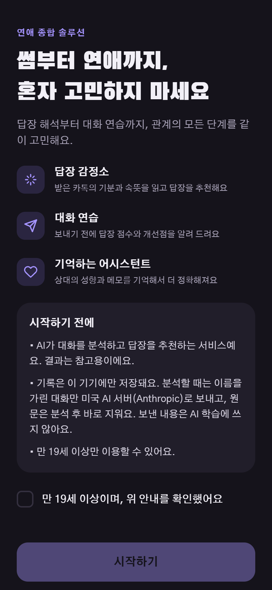
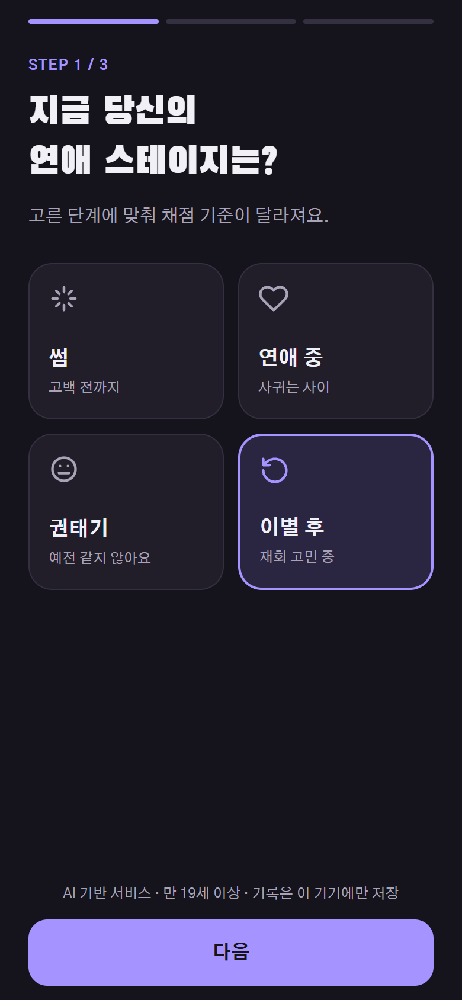
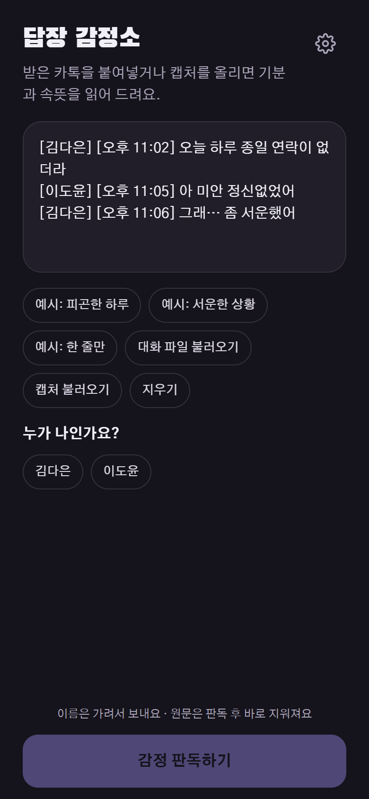
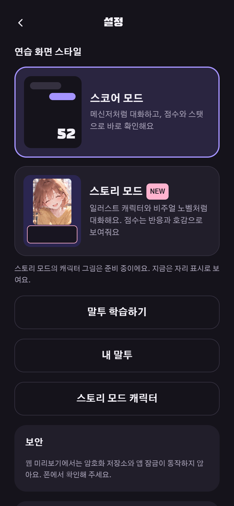
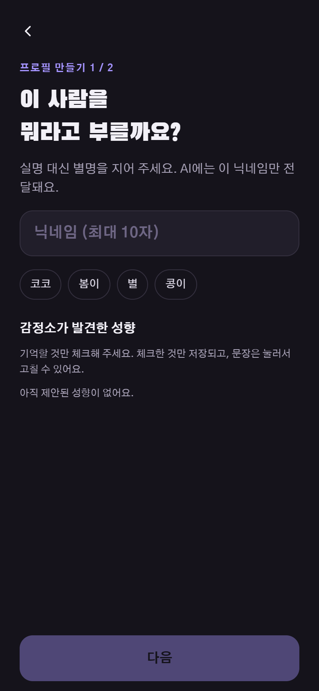
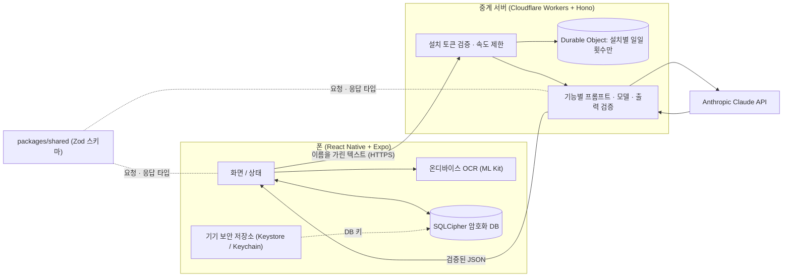

# LoveAssist

카카오톡 대화를 붙여넣거나 캡처로 올리면 상대의 기분과 속뜻을 읽어 주고, 답장을 추천하고, 보내기 전에 점수를 매겨 주는 한국어 연애 어시스턴트 앱입니다. 대화 기록은 기기 안의 암호화 DB에만 두고, AI 서버에는 이름을 가린 최소한의 텍스트만 보냅니다.

혼자 설계하고 구현했습니다. 정식 출시 전 단계이고, 지인 테스트까지 진행했습니다(결제와 본인인증은 아직 없습니다).

| 시작                                                     | 연애 단계 고르기                                       | 답장 감정소 입력                                    |
| -------------------------------------------------------- | ------------------------------------------------------ | --------------------------------------------------- |
|  |  |  |

| 스토리 모드 캐릭터                                    | 설정                                               | 상대 프로필 만들기                                   |
| ----------------------------------------------------- | -------------------------------------------------- | ---------------------------------------------------- |
|  |  |  |

스크린샷은 `npm run mobile:web`(Expo 웹 미리보기)로 390x844 크기에서 찍었고, 화면에 들어간 대화는 앱에 들어 있는 가상 예시입니다. AI 결과 화면은 중계 서버와 API 키가 있어야 나와서 싣지 않았습니다. 웹 미리보기는 암호화 DB와 앱 잠금 없이 메모리로만 동작합니다.

## 주요 기능

- 답장 감정소: 붙여넣은 대화(카톡 내보내기 형식 포함) 또는 캡처 이미지에서 상대의 기분과 속뜻을 해석하고, 상황별 답장을 추천합니다. 결과는 상대 정보를 가린 공유 카드로 만들 수 있습니다.
- 캡처 판독: Android에서 ML Kit 한국어 문자 인식으로 이미지를 기기 안에서 읽습니다. 말풍선 위치로 나와 상대를 가르고, 이미지는 서버로 보내지 않습니다. 자체 Expo 네이티브 모듈(`apps/mobile/modules/text-recognizer`)로 만들었고, iOS는 구현하지 않았습니다.
- 상대 프로필 3층 메모리: 원본 대화는 분석 직후 지우고, AI가 제안한 성향은 사용자가 승인한 것만 저장하고, 기념일 같은 메모는 사용자가 직접 씁니다.
- 대화 연습과 답장 채점: 프로필을 바탕으로 가상 상대와 대화하고, 보내기를 누를 때 공감도 · 성향 적합도 · 톤 · 템포로 채점해 개선 팁을 줍니다. 조종하는 식의 밀당은 높은 점수를 받지 못하게 프롬프트로 막았습니다. 화면은 점수 중심의 스코어 모드와 캐릭터가 나오는 스토리 모드 두 가지입니다.
- 내 말투 학습: 대화 파일에서 내 메시지 표본만 AI로 보내 말투를 요약하고, 승인한 요약만 저장해 추천 답장에 반영합니다.
- 앱 잠금: 생체인증(또는 기기 PIN)으로 잠그고, 최근 앱 목록의 미리보기 화면은 가립니다.

## 구조



| 위치              | 내용                                                                                          |
| ----------------- | --------------------------------------------------------------------------------------------- |
| `apps/mobile`     | React Native + Expo(Expo Router) 앱. 화면, 암호화 DB(Drizzle ORM), OCR 네이티브 모듈, 앱 잠금 |
| `apps/relay`      | Cloudflare Workers 위의 Hono 중계 서버. 프롬프트와 모델 선택은 서버에 있음                    |
| `packages/shared` | 앱과 서버가 함께 쓰는 도메인 타입과 API 요청 · 응답 Zod 스키마                                |
| `evals`           | 모델 비교 · 채점 일관성 점검 도구(가상 대화만 사용)                                           |
| `docs/security`   | 설계 원칙과 코드를 맞춰 본 보안 점검표                                                        |
| `docs/coaching`   | 추천 답장과 채점이 따르는 대화 코칭 기준                                                      |

## 기술 선택과 이유

- 로컬 우선, 암호화 DB: 대화와 상대 정보는 민감하다고 보고 서버에 저장하지 않는 쪽으로 설계했습니다. `expo-sqlite`의 SQLCipher 옵션으로 DB를 암호화하고, 256비트 무작위 키는 `expo-secure-store`에 "이 기기에서만" 접근 가능한 값으로 둡니다. 키와 DB가 맞지 않으면(백업 · 기기 이전으로 DB 파일만 넘어온 경우) DB를 새로 만듭니다. 모든 레코드에 id(UUID) · createdAt · updatedAt · deletedAt를 두고, 삭제는 deletedAt 표시와 내용 비우기로 처리해 나중에 동기화를 붙일 때 삭제 사실이 전달되게 했습니다.
- 무상태 중계 서버: API 키를 앱에 넣지 않으려고 중계 서버를 두었고, 서버는 요청을 전달만 합니다. 서버의 유일한 저장소는 하루 사용량을 세는 Durable Object(설치 ID별 날짜 · 기능별 횟수, 3일 뒤 삭제)입니다. 로그에는 경로 · 상태 코드 · 소요 시간 · 토큰 수만 남기고, 대화 내용이 로그에 없다는 것을 단위 테스트로 확인합니다.
- Zod 스키마 공유(npm workspaces): 요청 · 응답 형태를 `packages/shared`에 한 번만 정의해서 앱의 호출부, 서버의 입력 검증, LLM 출력 검증이 같은 스키마를 씁니다. 모델이 스키마에 맞지 않는 출력을 내면 서버에서 걸러집니다.
- 기능별 모델 분리: 감정소와 말투 학습은 Claude Sonnet, 시뮬레이션과 채점은 Claude Haiku를 씁니다. 모델별 비교와 비용 측정은 `evals`로 했고, LLM 연결부는 `apps/relay/src/llm`에 분리해 제공사를 바꾸기 쉽게 했습니다.
- 서버 지역 고정: 한국에서 들어온 요청이 홍콩 데이터센터에서 실행되면 Anthropic이 403을 돌려주는 것을 확인하고(`wrangler.jsonc` 주석에 기록), 서버를 미국 동부에 고정했습니다.
- Expo 웹 대응: 네이티브 전용 모듈(DB, OCR, 보안 저장소 등)마다 `*.web.ts` 구현을 두어 브라우저에서도 화면을 띄울 수 있게 했습니다.

## 보안과 개인정보 처리

`docs/security/release-checklist.md`에 원칙별로 어떻게 지키는지, 어느 코드가 근거인지, 어떻게 다시 확인하는지를 표로 정리했습니다.

- AI로 보내는 것은 이름을 "나" 또는 닉네임으로 바꾼 최근 대화(감정소 50줄, 연습 30줄), 상대 닉네임 · 관계 단계 · 성향 · 메모뿐입니다. 시각 · 날짜는 빼고, 보내기 전에 사용자가 내용을 확인하는 화면이 있습니다.
- 붙여넣은 원문은 화면 상태에만 두고 판독 성공 직후 비웁니다. DB 스키마에 원문 칸이 없습니다.
- 크래시 리포트(Sentry)는 개인정보 전송과 화면 캡처를 끄고, 전송 전에 메시지 · 변수 값 · 요청 · 사용자 정보를 지웁니다(`apps/mobile/src/lib/crash-scrub.ts`, 테스트 포함).
- AI가 제안한 성향에서 건강 · 성생활 · 종교 같은 민감정보 추정은 프롬프트로 막고, 서버가 결과에서 한 번 더 걸러 냅니다(`packages/shared/src/sensitive.ts`).
- 중계 서버 남용 방지: 초대 코드로 서명된 설치 토큰(HMAC-SHA256)을 발급하고, 토큰은 서버에 저장하지 않고 서명만 확인합니다. 설치 등록은 IP별, AI 호출은 설치별로 분당 제한을 걸고, 설치별 하루 한도(`wrangler.jsonc`의 `vars`)와 Anthropic 콘솔의 월 한도를 둡니다.
- Android 자동 백업을 끄고(`allowBackup: false`), 배포 번들에서 API 키 문자열이 나오지 않는지 확인하는 절차를 점검표에 적어 두었습니다.

알려진 한계: 앱 번들에 들어가는 초대 코드는 공개 출시용 인증이 아닙니다. 점검표에도 적었듯이 공개 출시 전에는 App Attest / Play Integrity 같은 기기 증명으로 바꿔야 합니다. 개인정보 처리방침과 이용약관은 법률 검토를 받지 않았고, 이 공개본에는 포함하지 않았습니다.

## 폴더 구조

```
apps/
  mobile/
    src/app/          화면(Expo Router): 온보딩, 감정소, 연습, 프로필, 설정
    src/components/   공통 UI, 캐릭터 그림, 점수 시트, 공유 카드
    src/db/           SQLCipher 열기, 키 관리, 스키마, 저장소 함수
    src/lib/          대화 파싱 · 이름 가리기, OCR 후처리, 채점 계산, 크래시 정리 등 순수 로직과 테스트
    src/services/     중계 서버 호출, 캡처, 공유 수신, 크래시 리포트
    src/security/     앱 잠금
    modules/          자체 Expo 모듈(문자 인식, Kotlin)
    drizzle/          DB 마이그레이션
  relay/
    src/app.ts        Hono 앱(라우트, 인증, 속도 제한)
    src/llm/          Anthropic 호출부
    src/prompts/      기능별 프롬프트
    src/quota.ts, usage-counter.ts   일일 한도(Durable Object)
    test/             서버 테스트
packages/shared/      Zod 스키마와 도메인 타입
evals/                모델 비교 · 일관성 점검 스크립트, 가상 대화 예시
docs/                 보안 점검표, 코칭 기준
```

## 실행 방법

Node.js 22 이상이 필요합니다.

```bash
npm install
```

브라우저 미리보기(암호화 DB와 앱 잠금 없이 메모리로 동작, AI 호출은 중계 서버가 있어야 동작):

```bash
npm run mobile:web
```

폰에서 실행하려면 SQLCipher 때문에 Expo Go가 아니라 개발 빌드(EAS)가 필요합니다. 빌드한 뒤에는 `npm run mobile`로 개발 서버를 엽니다. EAS 프로젝트는 각자 연결해야 하며(`eas init`), 이 공개본에서는 프로젝트 식별자를 뺐습니다.

중계 서버를 로컬에서 돌리려면 `apps/relay/.dev.vars.example`을 `.dev.vars`로 복사해 `ANTHROPIC_API_KEY`, `TOKEN_SECRET`, `INVITE_CODE`를 채운 뒤 실행합니다. 앱은 `apps/mobile/.env.example`을 `.env`로 복사해 `EXPO_PUBLIC_RELAY_URL`(기본값 `http://localhost:8787`)과 `EXPO_PUBLIC_INVITE_CODE`를 채웁니다.

```bash
npm run relay        # http://localhost:8787/health
```

## 테스트

```bash
npm test             # 앱 56개, 중계 서버 46개, evals 11개 (vitest)
npm run typecheck
npm run lint
npm run check        # 타입 검사 + 린트 + 테스트 + 포맷 검사
```

대화 파싱과 이름 가리기, OCR 후처리, 크래시 정보 제거, 중계 서버의 인증 · 한도 · 로그 내용, 민감정보 필터, 프롬프트 구성 등을 순수 함수 단위로 테스트합니다. `evals`의 스크립트는 Anthropic API를 실제로 호출하므로 비용이 듭니다(`npm run eval:run`, `eval:consistency`, `eval:sim`, `eval:coach`).

## 개발 기간과 규모

- 1인 개발. 커밋 기록상 2026-10-11부터 2026-10-14까지 4일, 커밋 52개입니다. 이 공개본은 마지막 시점의 소스만 담았고 커밋 기록은 옮기지 않았습니다.
- 코드 규모(테스트 제외, 빈 줄과 주석 포함, `wc -l` 기준): 앱 약 7,700줄(TypeScript/TSX, Kotlin 모듈 포함), 중계 서버 약 800줄, 공유 스키마 약 250줄, evals 약 900줄. 테스트 코드는 약 1,200줄입니다.

모든 권리 보유, 코드 열람만 허용.
